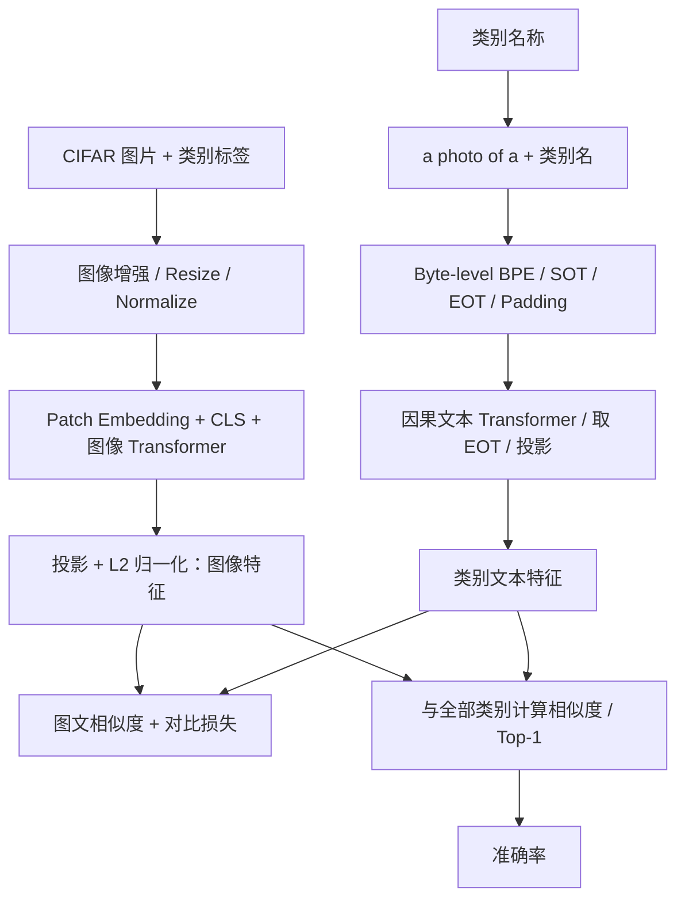
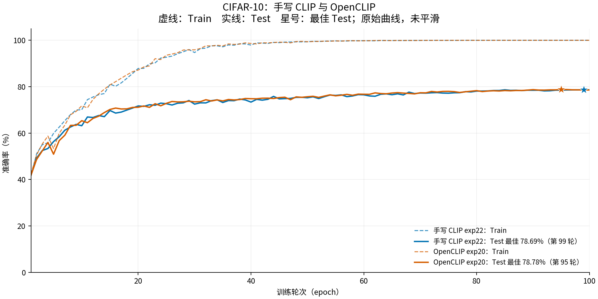
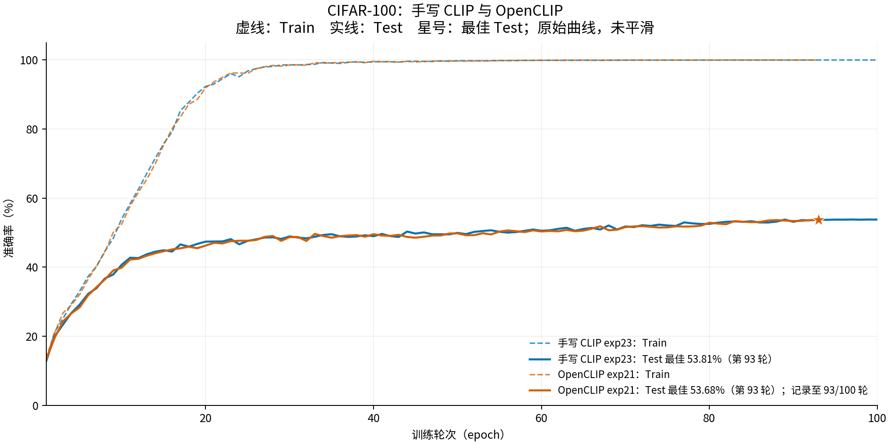
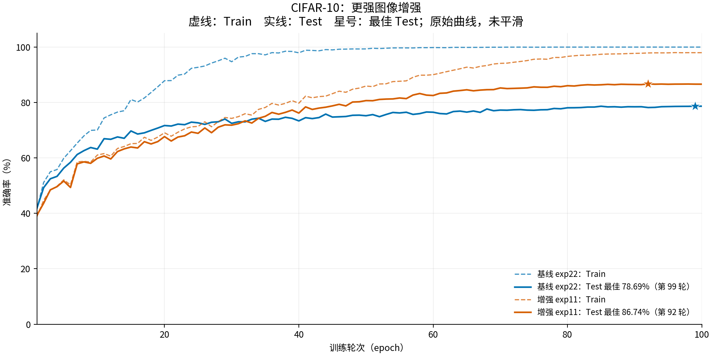
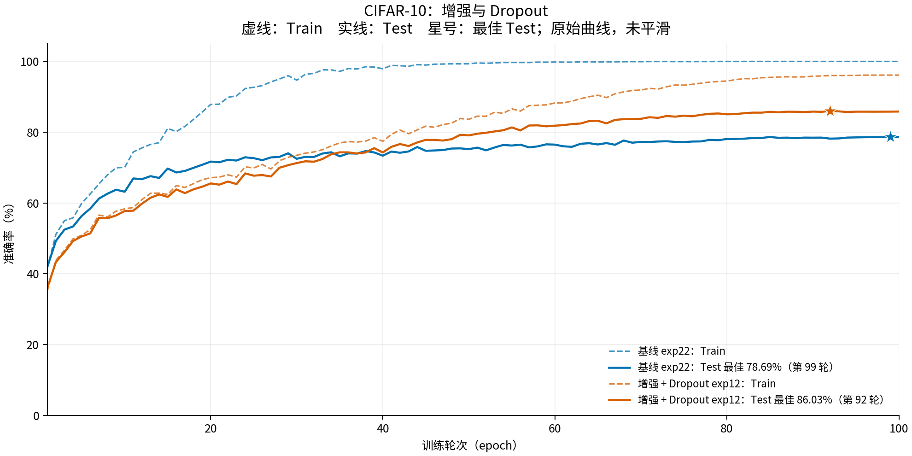
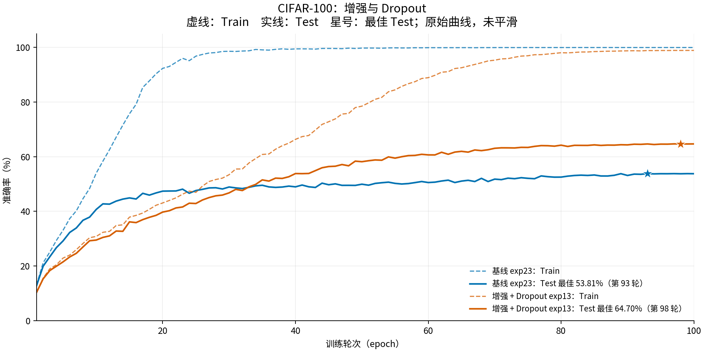
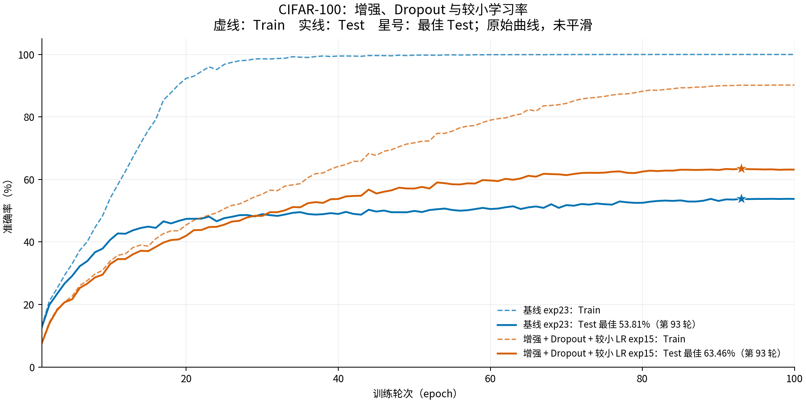

# 手写 CLIP 实验记录

本项目使用 PyTorch 手写 CLIP 双编码器、Byte-level BPE tokenizer，以及训练和评估 pipeline，并在 CIFAR-10/100 上与从零训练的 OpenCLIP 对比。图像来自 CIFAR，文本监督由类别名生成，例如 `a photo of a cat`。

## 1. 手写 CLIP pipeline

图像编码器将图片转换为 patch tokens，经 Transformer 和投影层得到归一化图像特征；文本编码器将类别提示词经 tokenizer 和因果 Transformer 编码，取 EOT 特征并投影。训练时按标签取出类别文本特征，计算图文相似度和对比损失；评估时每张图片与所有类别文本特征比较，取相似度最高的类别。

| 模块 | 代码 | 作用 |
|---|---|---|
| 数据与增强 | [data/dataset.py](data/dataset.py)、[data/preprocess.py](data/preprocess.py) | CIFAR-10/100、类别提示词、图像预处理 |
| Tokenizer | [data/tokenizer.py](data/tokenizer.py) | Byte-level BPE、SOT/EOT 和文本截断 |
| 双塔模型 | [model/](model/) | 图像与文本编码器、Transformer、特征投影 |
| 训练与评估 | [train.py](train.py)、[loss.py](loss.py)、[optim.py](optim.py)、[scheduler.py](scheduler.py) | 对比损失、AdamW、学习率调度、准确率评估 |

手写模型以类别提示词作为文本输入。CIFAR-10/100 的测试集各有 10,000 张图片；分类准确率按所有图片累计计算，每张图片在类别集合中独立预测一个 Top-1 类别。

## 2. CIFAR-10/100 从零训练

以下曲线均使用 ViT-B/32 尺寸、224 × 224 输入和 32 × 32 patch，模型从随机初始化开始训练。六张图使用相同的图幅与坐标范围：训练轮次 1～100、准确率 0～105%。虚线为无随机增强的 Train Accuracy，实线为 Test Accuracy；星号标记最佳 Test。曲线未平滑。

### 2.1 手写 CLIP 与 OpenCLIP

CIFAR-10 对比手写 `exp22` 与 OpenCLIP `exp20`，文本长度为 8；CIFAR-100 对比手写 `exp23` 与 OpenCLIP `exp21`，文本长度为 16。四组均使用 Batch 512、LR 3e-4、WD 0.05、Dropout 0 和 OpenCLIP 图像预处理。手写模型保留自己的优化器参数分组和学习率调度，因此曲线比较的是两套实际训练流程。

| CIFAR-10：手写 CLIP 与 OpenCLIP | CIFAR-100：手写 CLIP 与 OpenCLIP |
|:---:|:---:|
|  |  |

`exp21` 仅记录到第 93/100 轮，图中保留其实际曲线范围。

两组实现的最佳 Test Accuracy 接近；CIFAR-100 的 Train Accuracy 接近 100%，Test Accuracy 约为 54%，过拟合仍然明显。

### 2.2 手写模型的训练改进

每张图都使用初始手写配置作固定基线：CIFAR-10 为 `exp22`，CIFAR-100 为 `exp23`。`exp11` 加入更强图像增强，`exp12` 在此基础上加入图像侧 Dropout 0.1；`exp13` 结合增强与 Dropout 0.1，`exp15` 进一步将 LR 从 3e-4 降至 1e-4。`exp22/23` 使用 OpenCLIP 图像预处理，后续实验使用手写增强，因此各图展示的是相对于初始配置的整体变化。

| CIFAR-10：更强图像增强 | CIFAR-10：增强与 Dropout |
|:---:|:---:|
|  |  |

| CIFAR-100：增强与 Dropout | CIFAR-100：增强、Dropout 与较小学习率 |
|:---:|:---:|
|  |  |

图中蓝色为基线、橙色为改进。增强后的两组 CIFAR-10 实验均达到约 86% Test Accuracy；加入 Dropout 后 Train Accuracy 较低，最佳 Test 略低。CIFAR-100 降低 LR 后 Train Accuracy 较低，最佳 Test 仍以 `exp13` 为高。[原始曲线数据与重绘说明](docs/results/cifar_training/README.md)

## 3. CIFAR-100：Small 模型

三个实验均使用 224 × 224 输入、32 × 32 patch、6 层 Small 双塔、图像/文本宽度 384/256、Batch 512、Dropout 0.1、Weight Decay 0.05 和 BF16。主要变量为学习率。

| 实验 | 学习率 | 最佳 Test Accuracy | 同轮 Train Accuracy | 最佳 epoch | 日志截至 |
|---|---:|---:|---:|---:|---:|
| `exp2_small_lr1e-4` | 1e-4 | 55.49% | 65.46% | 90 | 100/100 |
| `exp3_small_lr3e-4` | 3e-4 | **62.64%** | 85.22% | 96 | 100/100 |
| `exp4_small_lr1e-3` | 1e-3 | 61.40% | 84.94% | 91 | 100/100 |

`exp3` 在这三组 Small 实验中取得最高 Test Accuracy。

## 4. 官方 CLIP ViT-B/32 零样本结果

使用 OpenAI 官方预训练权重、官方图像预处理和 tokenizer（context length 77），每类使用一个提示词 `a photo of a {}`。模型未在 CIFAR 上训练或微调，测试集覆盖全部 10,000 张图片。

| 测试集 | Top-1 Accuracy | 正确数 / 总数 | 混淆矩阵 |
|---|---:|---:|---|
| CIFAR-10 | **88.80%** | 8,880 / 10,000 | [PNG](docs/results/openai_clip_vit_b32/cifar10/confusion_matrix.png) · [指标](docs/results/openai_clip_vit_b32/cifar10/metrics.json) |
| CIFAR-100 | **64.15%** | 6,415 / 10,000 | [PNG](docs/results/openai_clip_vit_b32/cifar100/confusion_matrix.png) · [指标](docs/results/openai_clip_vit_b32/cifar100/metrics.json) |

每个数据集的[预测记录](docs/results/openai_clip_vit_b32/)、混淆矩阵计数及归一化数据均已归档。评估细节见[结果说明](docs/results/openai_clip_vit_b32/README.md)。

## 5. CC3M 训练记录

以下曲线是在 [**CC3M**](https://huggingface.co/datasets/pixparse/cc3m-wds) 数据集上训练到 **44,000 step**（batch_size=512，约 7.5 个 epoch）的记录，展示训练 Loss 和验证集图文检索 Recall。[原始 CC3M 数据集](https://ai.google.com/research/ConceptualCaptions/download)约有 330 万图文对。每次验证记录 1,024 个样本。

[SVG 图](docs/results/cc3m/cc3m_training.svg) · [逐步指标 CSV](docs/results/cc3m/metrics.csv) · [来源与导出说明](docs/results/cc3m/README.md)

截至 44,000 step，最近一次记录的 Image-to-Text Recall@1/5/10 为 **23.63% / 47.75% / 58.79%**；Text-to-Image Recall@1/5/10 为 **27.54% / 55.57% / 66.50%**。训练和验证指标的单位、采样方式及来源文件见[导出说明](docs/results/cc3m/README.md)。

使用 CC3M 训练结果在 CIFAR 上做 zero-shot 分类，Top-1 Accuracy 如下：

| 测试集 | Zero-shot Top-1 Accuracy |
|---|---:|
| CIFAR-10 | **47.73%** |
| CIFAR-100 | **19.01%** |

[CC3M 训练结果文件（Google Drive）](https://drive.google.com/file/d/1E1vhnSOkHlKq33rKQzqq3roI6qLDa0PS/view?usp=drive_link)。

## 参考文献

- Radford et al., 2021. [Learning Transferable Visual Models From Natural Language Supervision（CLIP）](https://arxiv.org/abs/2103.00020).
- [OpenAI CLIP 官方项目](https://github.com/openai/CLIP).
- [open_clip](https://github.com/mlfoundations/open_clip)
- [CC3M](https://huggingface.co/datasets/pixparse/cc3m-wds)
<!-- marks:settings panel=hidden -->
