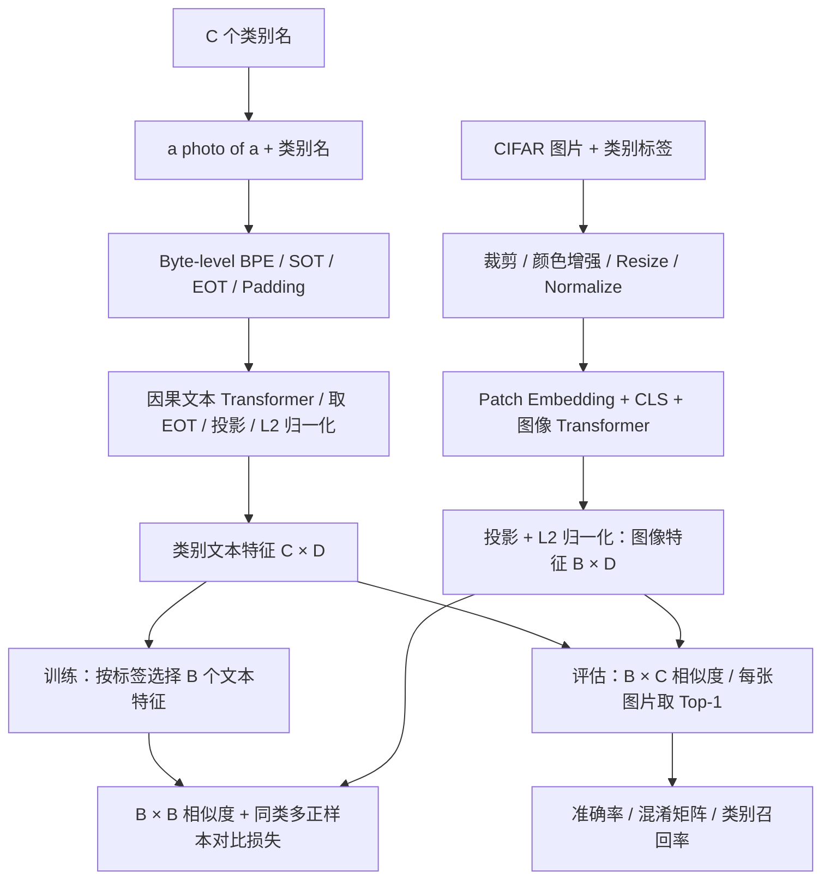
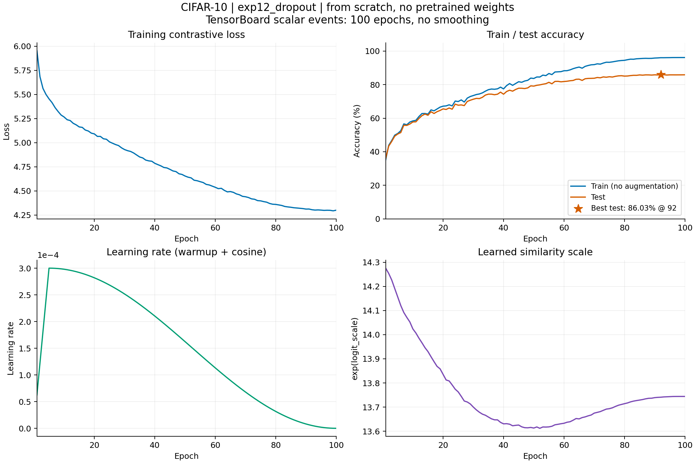
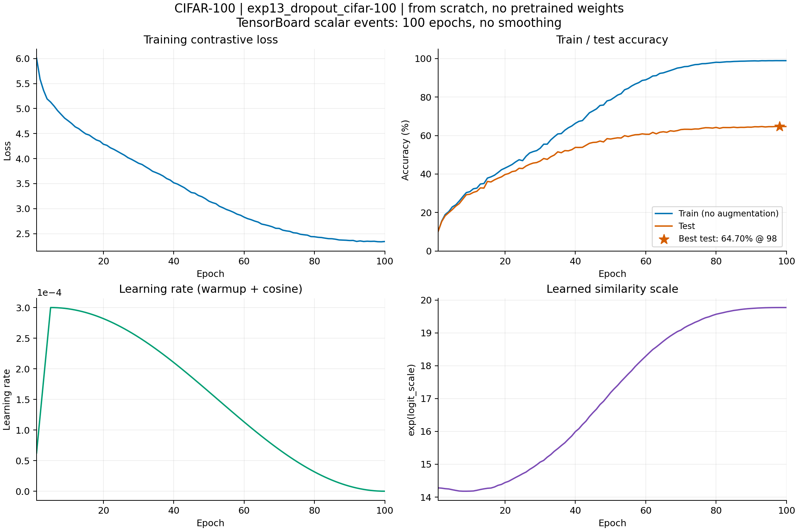
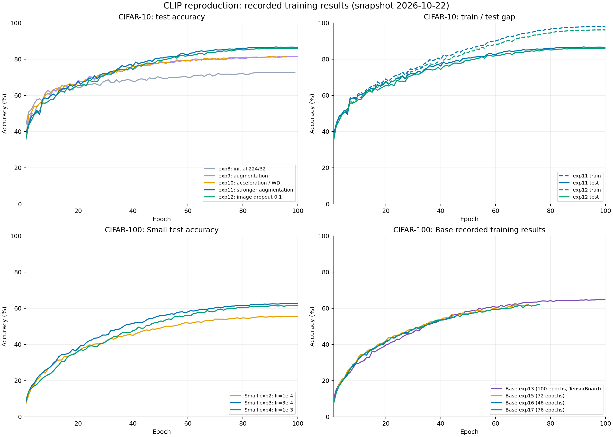
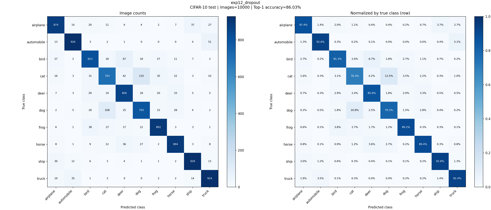
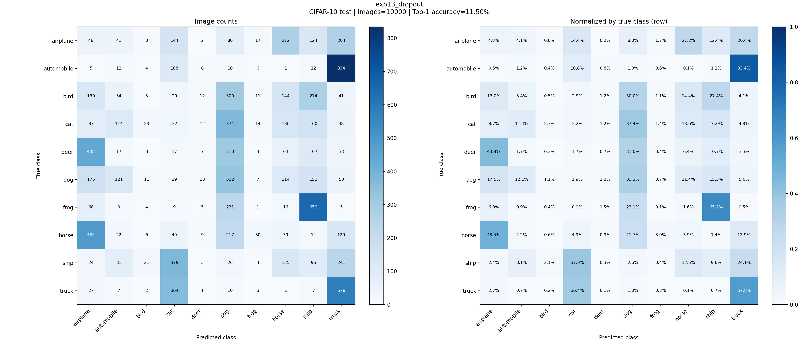

# 手写 CLIP：CIFAR 图文对齐与分类实验

使用 PyTorch 实现 CLIP 的双编码器、Byte-level BPE 分词、同类多正样本对比损失，以及训练、评估和可视化 pipeline。图像来自 CIFAR，文本监督由类别名生成，例如 `a photo of a cat`。

**手写 CLIP 实验均从随机初始化开始训练，图像编码器、文本编码器和 token embedding 均未加载预训练权重。** 分词器复用仓库内的 BPE merge 词表；OpenAI 官方预训练模型的零样本对照见 [§2.6](#26-官方预训练-clip零样本对照)。

| 任务 | 实验 | 当前可核验的 Top-1 |
|---|---|---:|
| CIFAR-10 → CIFAR-10，同数据集分类 | Base `exp11_more_aug` | **86.74%** |
| CIFAR-10 → CIFAR-10，同数据集分类 | Base `exp12_dropout` | **86.03%** |
| CIFAR-100 → CIFAR-100，同数据集分类 | Base `exp13_dropout` | **64.70%** |
| CIFAR-100 → CIFAR-100，同数据集分类 | Small `exp3_small_lr3e-4` | **62.64%** |
| CIFAR-100 → CIFAR-10，跨数据集迁移 | Base `exp13_dropout` | **11.50%** |
| 官方预训练 → CIFAR-10，零样本分类 | OpenAI CLIP ViT-B/32 | **88.80%** |
| 官方预训练 → CIFAR-100，零样本分类 | OpenAI CLIP ViT-B/32 | **64.15%** |

## 1. 手写 pipeline



### 1.1 实现与代码位置

| 模块 | 实现内容 | 代码 |
|---|---|---|
| 数据集与文本 | CIFAR-10/100、类名模板、缓存类别 token、增强、截断时保留 EOT | [data/dataset.py](data/dataset.py) |
| 分词器 | 文本清洗、Byte-to-Unicode、BPE 合并及缓存 | [data/tokenizer.py](data/tokenizer.py)、[data/bytes_to_unicode.py](data/bytes_to_unicode.py) |
| 图像编码器 | 卷积实现 patch embedding、CLS token、位置编码、Transformer、投影 | [model/ImageEncoder.py](model/ImageEncoder.py) |
| 文本编码器 | Token embedding、位置编码、因果注意力、EOT 特征与投影 | [model/TextEncoder.py](model/TextEncoder.py) |
| Transformer | 手写 block 组合、QKV 分头、残差连接、LayerNorm、QuickGELU | [model/Transformer.py](model/Transformer.py)、[model/MHA.py](model/MHA.py)、[model/ResAttenBlock.py](model/ResAttenBlock.py)、[model/LayerNorm.py](model/LayerNorm.py)、[model/GELU.py](model/GELU.py) |
| 双塔与损失 | 特征归一化、可学习温度、同类多正样本、双向交叉熵 | [model/clip.py](model/clip.py)、[loss.py](loss.py) |
| 训练工程 | AdamW 参数分组、warmup + cosine、BF16、断点续训、TensorBoard | [train.py](train.py)、[optim.py](optim.py)、[scheduler.py](scheduler.py) |
| 批量图像预处理 | 原始 uint8 图片搬到设备后做增强，避免逐图 PIL 处理 | [data/preprocess.py](data/preprocess.py) |

网络结构和数据流由仓库代码组合实现；注意力核心调用 PyTorch `scaled_dot_product_attention`，LayerNorm 调用 `F.layer_norm`，优化器使用 `torch.optim.AdamW`。

### 1.2 模型尺寸

Base / Small 是本仓库的实验命名。下表的当前 Base 配置来自 [config.py](config.py)，历史实验以各自保存的配置为准。

| 参数 | 当前 Base | Small 历史实验 |
|---|---:|---:|
| 输入 / Patch | 224 × 224 / 32 × 32 | 224 × 224 / 32 × 32 |
| 图像 token 数（含 CLS） | 50 | 50 |
| 图像 / 文本宽度 | 768 / 512 | 384 / 256 |
| 图像 / 文本注意力头数 | 12 / 8 | 6 / 4 |
| 每个编码器的层数 | 12 | 6 |
| 图像 / 文本 MLP 隐层 | 3072 / 2048 | 1536 / 1024 |
| 对齐特征维度 D | 512 | 256 |
| 当前有效文本长度 | 16(cifar-10:8) | CIFAR-100 实验为 16 |
| 图像侧 Dropout | 0.1 | 0.1 |

图像侧 Dropout 位于注意力输出和 MLP 内；文本侧及 SDPA 注意力概率的 Dropout 为 0。

### 1.3 训练：同类图片都是正样本

当前训练使用类别模板，而非每张图片独有的描述。一个 batch 中可以有很多同类图片。先编码 C 个类别文本，再按标签取出 B 个文本特征，形成 `[B, B]` 相似度矩阵：

```python
# model/clip.py 中 forward 的核心逻辑
img_features = self.encode_image(imgs)          # [B, D]，已归一化
class_features = self.encode_text(class_tokens)  # [C, D]，已归一化
text_features = class_features[labels]          # [B, D]，同类文本会重复
logits = img_features @ text_features.T * self.logit_scale.exp()
```

损失使用同类掩码，避免把 batch 中的同类样本当成负样本：

```python
# loss.py 中 contrastive_loss 的核心逻辑
positive_mask = labels[:, None] == labels[None, :]
targets = positive_mask.float()
targets = targets / targets.sum(dim=1, keepdim=True)

loss_cross = torch.nn.CrossEntropyLoss()
loss = (loss_cross(logits, targets) + loss_cross(logits.T, targets)) / 2
```

若一行有 m 个正样本，其目标概率各为 `1/m`。这与只用单位矩阵标签的一对一图文对比损失不同，也意味着训练 loss 不需要趋于 0；batch 大小、类别数和同类样本数变化后，loss 数值不宜直接横向比较。

### 1.4 评估：每张图片独立做 C 分类

```python
# train.py / zero_shot.py 的 Top-1 评估核心
class_features = model.encode_text(class_tokens)  # [C, D]，评估开始时计算一次
img_features = model.encode_image(imgs)           # [B, D]
logits = img_features @ class_features.T * model.logit_scale.exp()  # [B, C]
preds = logits.argmax(dim=1)
correct += (preds == labels).sum()
total += labels.size(0)
```

CIFAR-10 中即使 `B=512`，评估矩阵仍然是 `[512, 10]`。每一行选择一个类别，同一类别可以被多张图片同时预测。总体准确率为所有 batch 累计正确数除以图片总数，包含最后不足一个 batch 的图片。

CIFAR-10 和 CIFAR-100 的训练集均为 50,000 张，测试集均为 10,000 张。当前使用官方测试集评估并选择最佳模型，没有独立划分验证集。

### 1.5 数据增强与训练工程

当前 CPU 图像增强包括随机裁剪（面积 0.4～1.0、宽高比 3/4～4/3、随机 bilinear/bicubic）、水平翻转（0.5）、颜色扰动（0.8）、灰度化（0.2）及随机擦除（0.25）。归一化使用对应 CIFAR 数据集的均值、标准差。

GPU 路径基于 Kornia，在 32 × 32 原图上先做颜色变换，再裁剪放大；CPU 路径的变换顺序与插值实现有所不同。评估时关闭随机增强，`model.eval()` 关闭 Dropout。

训练使用 AdamW、线性 warmup 和余弦学习率衰减，支持 BF16。温度参数初始对应 `1/0.07`，其指数上限限制为 100。原始图片批量搬运、预取和设备端累计统计减少 CPU 开销及同步。

## 2. 实验结果

以下准确率均为百分比。手写模型的 Train 使用无随机增强的训练集评估；表中 Train/Test 取自各实验最佳测试准确率对应的同一轮，差距为 Train − Test（百分点）。[完整数据](docs/results/experiment_summary.csv)

### 2.1 CIFAR-10：图像增强与抑制过拟合

使用 Base 224/32、学习率 `3e-4`。初始模型训练准确率达到 100%，测试准确率只有 72.71%，出现明显过拟合。后续逐步增加图像增强，并尝试 Weight Decay（WD）和图像侧 Dropout。

| 实验 | 主要调整 | Train | Test | 差距 |
|---|---|---:|---:|---:|
| `exp8` | 初始配置 | 100.00 | 72.71 | 27.29 |
| `exp9` | 加入图像增强 | 99.85 | 81.48 | 18.37 |
| `exp10` | 图像增强 + WD 0.05 | 99.78 | 81.44 | 18.34 |
| `exp11` | 更强图像增强 + WD 0.05 | 97.89 | **86.74** | 11.15 |
| `exp12` | 在 exp11 基础上加入 Dropout 0.1 | 96.04 | **86.03** | 10.01 |

图像增强: 从初始的 72.71% 提升到 81.48%，更强增强与 WD 的组合进一步达到 86.74%。采用 WD 0.05 的 `exp10` 与 `exp9` 的测试准确率接近。

Dropout: 将训练准确率从 97.89% 降至 96.04%，Train/Test 差距进一步缩小，但测试准确率下降 0.71 个百分点。它降低了拟合程度，未带来额外的测试准确率提升。

### 2.2 CIFAR-100：学习率、AdamW 与温度参数的调整

使用 Base 224/32、Batch 512、图像 Dropout 0.1 和 WD 0.05。`exp13` 的训练准确率达到 98.90%，测试准确率为 64.70%，差距为 34.20 个百分点。后续降低学习率，并调整 AdamW 的初始化参数及 `logit_scale` 的权重衰减设置。

| 实验 | 主要调整 | 学习率 | Train | Test | 差距 |
|---|---|---:|---:|---:|---:|
| `exp13` | 图像增强 + WD + Dropout 基线 | 3e-4 | 98.90 | **64.70** | 34.20 |
| `exp15` | 降低学习率 | 1e-4 | 85.78 | 62.07 | 23.71 |
| `exp16_adamw` | 显式设置 AdamW 的 betas、eps | 1e-4 | 67.99 | 56.00 | 11.99 |
| `exp17_adamw_logit_scale` | 在 exp16 基础上，logit_scale 不做 WD | 1e-4 | 85.02 | 62.18 | 22.84 |

`adamw` 表示显式初始化优化器参数 `betas=(0.9, 0.98)`、`eps=1e-6`；`logit_scale` 表示将该温度参数排除在 WD 之外。

`exp15`～`exp17` 因测试曲线走势与 `exp13` 相近而提前结束。它们在已观察阶段的训练准确率更低，过拟合有所缓解：同样在第 46 轮，四组测试准确率都约为 56%，但 `exp13` 的 Train/Test 差距为 17.34，`exp15`、`exp16`、`exp17` 分别为 12.96、11.99、12.03。当前没有超过 `exp13` 的最佳测试准确率。

### 2.3 CIFAR-100：Small，224/32

使用 6 层 Small 模型、图像/文本宽度 384/256、Batch 512、Dropout 0.1 和 WD 0.05，比较不同学习率。

| 实验 | 学习率 | 最佳 Test | 同轮 Train | 最佳 epoch | 日志截至 |
|---|---:|---:|---:|---:|---:|
| `exp2_small_lr1e-4` | 1e-4 | 55.49 | 65.46 | 90 | 100/100 |
| `exp3_small_lr3e-4` | 3e-4 | **62.64** | 85.22 | 96 | 100/100 |
| `exp4_small_lr1e-3` | 1e-3 | 61.40 | 84.94 | 91 | 100/100 |

### 2.4 训练曲线

两组完整训练曲线展示 loss、Train/Test 准确率、学习率和 `exp(logit_scale)`。

**CIFAR-10：`exp12_dropout`**



[完整数值 CSV](docs/results/tensorboard/exp12_dropout.csv) · [SVG](docs/results/tensorboard/exp12_dropout.svg)

**CIFAR-100：`exp13_dropout`**



[完整数值 CSV](docs/results/tensorboard/exp13_dropout_cifar-100.csv) · [SVG](docs/results/tensorboard/exp13_dropout_cifar-100.svg)

不同配置的对照曲线：



[SVG 版本](docs/results/training_curves.svg)

### 2.5 混淆矩阵与迁移结果

两张矩阵均评估 CIFAR-10 测试集。**行是真实类别，列是预测类别**；左图为计数，右图为按真实类别归一化的比例。

**CIFAR-10 训练的 `exp12_dropout` → CIFAR-10：86.03%。**



[原始计数](docs/results/cifar10_exp12/confusion_matrix.csv) · [归一化矩阵](docs/results/cifar10_exp12/confusion_matrix_normalized.csv)

**CIFAR-100 训练的 `exp13_dropout` → CIFAR-10：11.50%。**



[原始计数](docs/results/cifar100_to_cifar10_exp13/confusion_matrix.csv) · [归一化矩阵](docs/results/cifar100_to_cifar10_exp13/confusion_matrix_normalized.csv)

| CIFAR-10 类别 | CIFAR-10 exp12 召回率 | CIFAR-100 exp13 迁移召回率 |
|---|---:|---:|
| airplane | 87.4 | 4.8 |
| automobile | 92.6 | 1.2 |
| bird | 81.3 | 0.5 |
| cat | 70.3 | 3.2 |
| deer | 85.6 | 0.7 |
| dog | 79.3 | 33.2 |
| frog | 89.2 | 0.1 |
| horse | 89.4 | 3.9 |
| ship | 92.8 | 9.6 |
| truck | 92.4 | 57.8 |

同数据集模型主要混淆猫与狗。跨数据集模型存在明显预测偏向，整体准确率为 11.50%，接近 10 分类的随机基线，尚未表现出有效的跨数据集迁移能力。

### 2.6 官方预训练 CLIP：零样本对照

实测 OpenAI CLIP ViT-B/32 官方权重，使用官方分词器（长度 77）和 224 × 224 图像预处理，每类仅用 `a photo of a {}`，类名中的下划线替换为空格。不训练、不微调。两个测试集各评估全部 10,000 张图片。

| 测试集 | 手写 Base 最佳 Test | 官方 ViT-B/32 零样本 Top-1 | 正确数 / 总数 |
|---|---:|---:|---:|
| CIFAR-10 | 86.74（exp11） | **88.80** | 8880 / 10000 |
| CIFAR-100 | **64.70**（exp13） | 64.15 | 6415 / 10000 |

官方模型使用大规模图文预训练；手写模型使用 CIFAR 类别监督并按测试集选最佳轮次，预处理也不同。[设置、来源与复跑说明](docs/results/openai_clip_vit_b32/README.md)

- CIFAR-10：[混淆矩阵](docs/results/openai_clip_vit_b32/cifar10/confusion_matrix.png) · [计数 CSV](docs/results/openai_clip_vit_b32/cifar10/confusion_matrix.csv) · [实测记录](docs/results/openai_clip_vit_b32/cifar10/metrics.json)
- CIFAR-100：[混淆矩阵](docs/results/openai_clip_vit_b32/cifar100/confusion_matrix.png) · [计数 CSV](docs/results/openai_clip_vit_b32/cifar100/confusion_matrix.csv) · [实测记录](docs/results/openai_clip_vit_b32/cifar100/metrics.json)

```bash
python -m pip install -r requirements.txt
python scripts/evaluate_openai_clip.py --device cuda
```

## 参考文献

- Radford et al., 2021. [Learning Transferable Visual Models From Natural Language Supervision（CLIP）](https://arxiv.org/abs/2103.00020).
- [OpenAI CLIP 官方项目](https://github.com/openai/CLIP).

<!-- marks:settings panel=hidden -->
