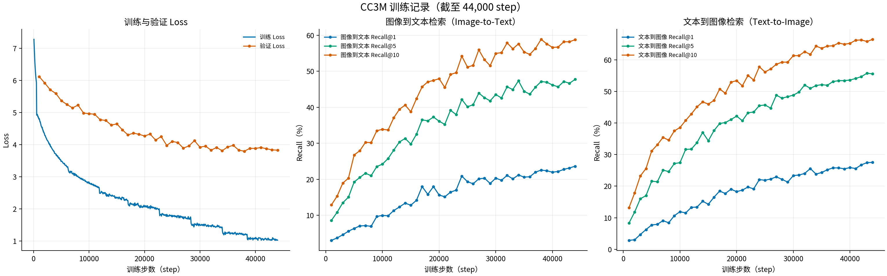

# CC3M TensorBoard 训练记录

数据由项目内 `outputs/tensorboard/cc3m_tensorboard.zip` 导出。多个 TensorBoard event files 按全局 `step` 合并，记录覆盖训练 step 50–44,000；压缩包目前没有提供训练完成标记或最终 checkpoint，因此这里仅报告已记录过程。



截至 step 44,000，最后一次记录的训练 Loss 为 1.0259，验证指标如下。Recall 数值以百分比表示。

| 验证方向 | Recall@1 | Recall@5 | Recall@10 |
|---|---:|---:|---:|
| Image-to-Text | 23.63% | 47.75% | 58.79% |
| Text-to-Image | 27.54% | 55.57% | 66.50% |

每次验证的 `val/samples` 记录为 1,024，因此这些 Recall 是该次记录样本上的结果，不应视为完整验证集指标。训练 Loss 按 TensorBoard 原始记录导出；Recall 原始值为 0–1，CSV 中转换为百分比。未对曲线做平滑。

项目训练者另提供了该 CC3M 训练结果在 CIFAR 上的 zero-shot Top-1 Accuracy：CIFAR-10 为 **47.73%**，CIFAR-100 为 **19.01%**。[训练结果文件（Google Drive）](https://drive.google.com/file/d/1E1vhnSOkHlKq33rKQzqq3roI6qLDa0PS/view?usp=drive_link)。这些分类指标不在本目录的 TensorBoard scalar CSV 中，评估设置和样本数未随日志归档。

| 文件 | 内容 |
|---|---|
| [cc3m_training.png](cc3m_training.png) / [SVG](cc3m_training.svg) | Train/Validation Loss、Image-to-Text 和 Text-to-Image Recall@1/5/10 曲线 |
| [metrics.csv](metrics.csv) | 按 step 对齐的原始 scalar 数值；Recall 列为百分比 |
| [provenance.json](provenance.json) | 输入压缩包 SHA-256、合并的 event files、步数范围和指标来源 |

从项目根目录重绘并重新导出：

```bash
python scripts/plot_cc3m_results.py
```

若系统没有可用中文字体，可通过 `--font_path /path/to/NotoSansCJKsc-Regular.otf` 指定字体。该图的标题、坐标轴和图例使用中文，CLIP、CC3M、Loss、Recall@K 等专业术语保留英文。
