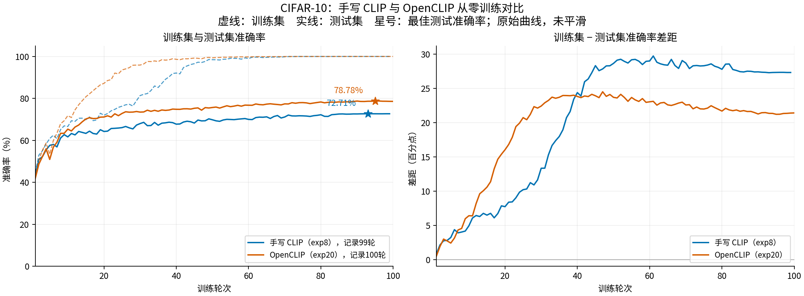
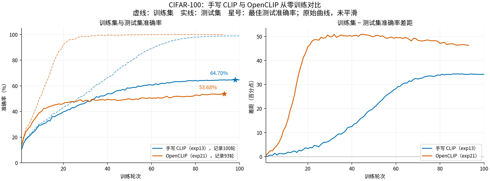

# 手写 CLIP 与 OpenCLIP：从零训练对照

整理日期：2026-10-23。CIFAR-10 比较手写 `exp8` 与 OpenCLIP `exp20`；CIFAR-100 比较强增强、Dropout 0.1 的手写 `exp13` 与 OpenCLIP `exp21`。双方均随机初始化，使用 224/32 输入与 Patch、Base 双塔尺寸和 QuickGELU。

以下 Train/Test 取最佳 Test 对应的同一轮，差距为 Train − Test（百分点）。

| 数据集 | 实验 | 最佳 epoch | 同轮 Train | 最佳 Test | 差距 |
|---|---|---:|---:|---:|---:|
| CIFAR-10 | 手写 `exp8_origin-224` | 93 | 100.00 | 72.71 | 27.29 |
| CIFAR-10 | OpenCLIP `exp20_open_clip` | 95 | 100.00 | 78.78 | 21.22 |
| CIFAR-100 | 手写 `exp13_dropout_cifar-100` | 98 | 98.90 | 64.70 | 34.20 |
| CIFAR-100 | OpenCLIP `exp21_open_clip` | 93 | 99.98 | 53.68 | 46.30 |

CIFAR-10 的 OpenCLIP 最佳 Test 高 6.07 个百分点，Train/Test 差距缩小 6.07 个百分点；CIFAR-100 的手写方案最佳 Test 高 11.02 个百分点，OpenCLIP 的差距增大 12.10 个百分点。

`exp8` 的记录到第 99/100 轮，末轮 Train/Test 为 100.00% / 72.68%；`exp20`、`exp13` 均有完整 100 轮，末轮分别为 100.00% / 78.58%、98.91% / 64.68%。`exp21` 的 TensorBoard、CSV 和日志均只到第 **93/100** 轮，末轮为 99.98% / 53.68%。

**CIFAR-10：手写 exp8 与 OpenCLIP exp20。**



**CIFAR-100：手写 exp13 与 OpenCLIP exp21。**



[CIFAR-10 SVG](cifar10_comparison.svg) · [CIFAR-100 SVG](cifar100_comparison.svg) · [汇总 CSV](summary.csv)

## 训练设置差异

| 设置 | CIFAR-10 手写 exp8 | CIFAR-10 OpenCLIP exp20 | CIFAR-100 手写 exp13 | CIFAR-100 OpenCLIP exp21 |
|---|---|---|---|---|
| 文本长度 / Batch | 77 / 256 | 8 / 512 | 16 / 512 | 16 / 512 |
| 图像 Dropout | 0 | 0 | 0.1 | 0 |
| 图像增强 | Resize、随机水平翻转 | 默认随机裁剪，面积 0.9～1.0 | 强裁剪、翻转、颜色扰动、灰度、擦除 | 默认随机裁剪，面积 0.9～1.0 |
| 归一化 | CIFAR-10 | CLIP | CIFAR-100 | CLIP |
| WD | 0.01 | 0.05 | 0.05 | 0.05 |
| AdamW betas / eps | (0.9, 0.999) / 1e-8 | (0.9, 0.98) / 1e-6 | (0.9, 0.999) / 1e-8 | (0.9, 0.98) / 1e-6 |

四组均使用 LR 3e-4，计划 100 epochs，warmup 5 epochs，BF16 训练、seed 42；OpenCLIP 为 3.3.0。四组的 `logit_scale` 均不做 WD；OpenCLIP 额外按一维参数排除 WD，手写按参数名分组。当前比较的是已有训练方案，不能单独归因于模型实现或文本长度。

除 `exp8` 外，Train 使用无随机增强的完整训练集；`exp8` 复用含随机翻转、`drop_last=True` 的训练 loader，此处保留其原始报告值。

## 数据出处与重绘

数值来自 `outputs/tensorboard/` 下四组实验的原始 `events.out.tfevents.*`，每轮含 loss、Train/Test accuracy、LR、`exp(logit_scale)` 五个标签；四组分别有 99、100、100、93 个连续 epoch，无重复或缺失。完整数值保留在本目录四份同名 CSV 中，[provenance.json](provenance.json) 记录来源和哈希，[settings.json](settings.json) 保存实际配置与证据。

配置来自 `~/autodl-tmp/model/` 下各实验的 `config.py` / `info.txt` 或 OpenCLIP `config.json`，并与训练日志及可用的 `metrics.csv` 交叉核对。手写实验的 AdamW betas、eps、WD 从保存 checkpoint 的小型 pickle 元数据核实，未加载权重张量；`exp8` 的增强与 Train 评估方式结合同期源码确认。原有历史快照保持不变。

从项目根目录执行，仅需仓库 CSV 和 Matplotlib，无需 PyTorch、TensorBoard 或 GPU：

```bash
python scripts/plot_tensorboard_curves.py --open_clip_comparison
```

重新从原始事件导出后绘图（需要 TensorBoard）：

```bash
python scripts/plot_tensorboard_curves.py --open_clip_comparison \
  --event_root outputs/tensorboard
```

绘图自动查找 `.cache/` 或系统中的中文字体，也可通过 `--font_path` 指定字体文件。
